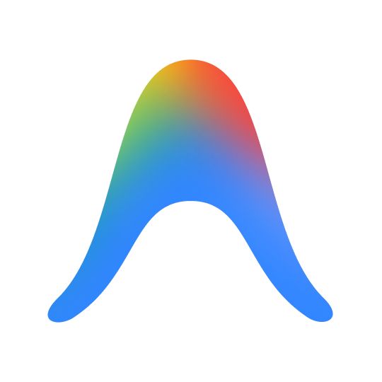

<h1 align="center">Hey  I'm Jaiyansh</h1>

  

 🎓 BTech CSE (Cyber Security & Digital Forensics)
  🏫 Vellore Institute of Technology, Bhopal

#### 🚀 Currently Learning:
- Networking   
- Linux (Kali Linux)  
- Digital Forensics Tools
- Programming Fundamentals

#### 🧠 Technical Interests
- Cybersecurity 
- Digital Forensics
- Linux & Open Source Tools

## 🛠️ Skills & Tech Stack

### 💻 Programming Languages

  
  
  
  
  
  

### 🌐 Web Technologies & Styling

  
  
  

### ⚛️ Frameworks & Runtimes

  
  
  

### 🗄️ Backend Services & Platforms

  
  

### ⚙️ Systems & Development Tools

  
  
  
  
  
  
  

## 🗽 GitHub Stats

> 💡 Click the graph to explore the interactive contribution scanner.

  

> Every green square is just a pixel. The story behind it isn't. 💚

## 🔗 Connect with Me

  
  &nbsp;&nbsp;&nbsp;
  
  &nbsp;&nbsp;&nbsp;
  

 

 

  

